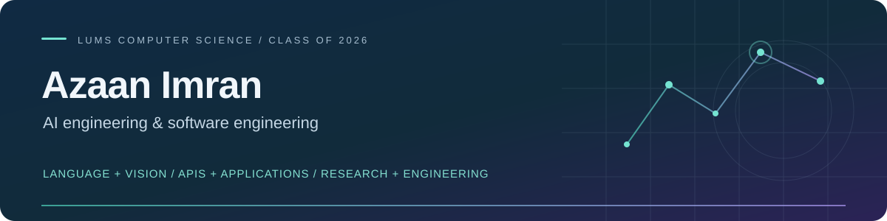

  

  <a href="mailto:azee.imran@gmail.com">Email</a> &nbsp; / &nbsp;
  <a href="https://www.linkedin.com/in/azaan-imran-04748a249/">LinkedIn</a> &nbsp; / &nbsp;
  <a href="https://github.com/azaan-imran192/Academic-Projects/tree/main">Academic portfolio</a>

## AI engineering, backed by software and research

I'm an **AI Engineer at Royal Cyber Inc. and a LUMS BS Computer Science graduate (2026)**. My work spans AI agent workflows, backend services and API development, supported by hands-on full-stack projects and computer vision research.

I bring **Python and AI integration experience**, **React/Node.js and database development**, and a research approach to evaluating model behavior. I'm interested in engineering roles where useful AI capabilities meet reliable software.

## Engineering & research experience

| Role | Focus |
|---|---|
| **AI Engineer · Royal Cyber Inc.** April 2026–present | Contribute to **Create with AI**, **Knowledge Sources**, AI agent workflows, and backend API development/integrations. Develop Python automation and access-control features; validate AI behavior with Playwright/API regression tests. |
| **Data Analytics Intern · Systems Limited** June–August 2025 | SSIS and Azure Data Factory pipelines, SQL Server validation/optimization and Power BI reporting. |
| **Research Intern → FYP · CVGL, LUMS** January 2025–May 2026 | Plant disease classification and phenotyping under Dr. Murtaza Taj; deep-learning experiments and a dashboard backend for plant measurements. |

## Selected work

<table>
<tr>
<td width="50%" valign="top">
<h3><a href="https://github.com/azaan-imran192/Academic-Projects/tree/main/Natural-Language-Processing/Urdu-Roman-Urdu-LLM-Safety">Urdu / Roman Urdu LLM Safety</a></h3>

Screens Urdu/Roman Urdu prompts before LLM generation using mBERT, lexicon matching and transliteration.

<strong>Milestone:</strong> Streamlit demo verified with the actual mBERT checkpoint.

<code>PyTorch</code> <code>Transformers</code> <code>Streamlit</code>

With Ahmad Bilal Habib.
</td>
<td width="50%" valign="top">
<h3><a href="https://github.com/azaan-imran192/Academic-Projects/tree/main/Deep-Learning-Computer-Vision/Plant-Research">Plant Research</a></h3>

Leaf-disease classification research and a related API for plant traits and temporal measurements.

<strong>Reported result:</strong> 79.32% accuracy on Cropped PlantDoc; historical research evaluation.

<code>TensorFlow</code> <code>Django REST</code> <code>OpenCV</code>

Classification research with Hanzalah Sohail Faraz and Murtaza Taj; further FYP attribution in the project.
</td>
</tr>
<tr>
<td width="50%" valign="top">
<h3><a href="https://github.com/azaan-imran192/Academic-Projects/tree/main/Deep-Learning-Computer-Vision/Building-Height-Estimation">Building Height Estimation</a></h3>

Estimates building height from RGB/SAR imagery, comparing baseline and alternative models on DFC2023.

<strong>Recorded result:</strong> Improvement 2 achieves 6.8623 m RMSE in saved experimental outputs.

<code>PyTorch</code> <code>rasterio</code> <code>GDAL</code>

With Muhammad Ibrahim; upstream model references credited.
</td>
<td width="50%" valign="top">
<h3><a href="https://github.com/azaan-imran192/Academic-Projects/tree/main/Databases/CineLog">CineLog</a></h3>

Supports movie discovery, reviews and watchlists through a Windows client, ASP.NET API and SQL Server.

<strong>Milestone:</strong> both desktop and API applications compile successfully.

<code>C# / .NET</code> <code>SQL Server</code> <code>WinForms</code>

With Hanzalah Sohail Faraz, Muhammad Hashaam Tauseef and Raahem Azam.
</td>
</tr>
<tr>
<td width="50%" valign="top">
<h3><a href="https://github.com/azaan-imran192/Academic-Projects/tree/main/Software-Engineering/Culinary-Cloud">Culinary Cloud</a></h3>

Brings recipe sharing, discovery and discussions into a full-stack React/Express application.

<strong>Milestone:</strong> frontend production build verified.

<code>React</code> <code>Node.js</code> <code>MongoDB</code>

Shared coursework with Hanzalah Sohail; further source credits in the project.
</td>
<td width="50%" valign="top">
<h3><a href="https://github.com/azaan-imran192/Academic-Projects/tree/main/Machine-Learning/Urdu-News-Classification">Urdu News Classification</a></h3>

Classifies Urdu news into five topics using custom statistical and neural models.

<strong>Reproduced result:</strong> Naive Bayes reaches 97.92% accuracy on 289 held-out rows.

<code>Python</code> <code>scikit-learn</code> <code>PyTorch</code>

With Hanzalah Sohail Faraz, Basil Hassan and Mujeeb Asad.
</td>
</tr>
</table>

Also explore [Mobile Usage Analysis](https://github.com/azaan-imran192/Academic-Projects/tree/main/Data-Science/Mobile-Usage-Analysis) and [ParkinsonPal's HCI research and design](https://github.com/azaan-imran192/Academic-Projects/tree/main/Human-Computer-Interaction/ParkinsonPal).

These are collaborative academic projects. [Verification records](https://github.com/azaan-imran192/Academic-Projects/tree/main/docs/VERIFICATION.md) cover methods, tests and known limitations. **Status:** the NLP pipeline is an academic safety demo; the plant dashboard frontend remains on licensing hold. Live-service/database integrations and full research reruns remain external dependencies. Detailed evaluation caveats stay in each project README.

## Tools I work with

**Models & data**

Hugging Face Transformers · pandas · NumPy · SQL · Power BI · Azure Data Factory

**Software & delivery**

REST APIs · FastAPI · Playwright · SQL Server · MongoDB · RAG workflows

<strong>GitHub activity</strong> · public statistics

 

 
A compact view of public activity; professional and private work is not fully represented. Supplied by an external service.

---

Interested in language technology, computer vision or building useful AI-backed software? [Get in touch](mailto:azee.imran@gmail.com).
